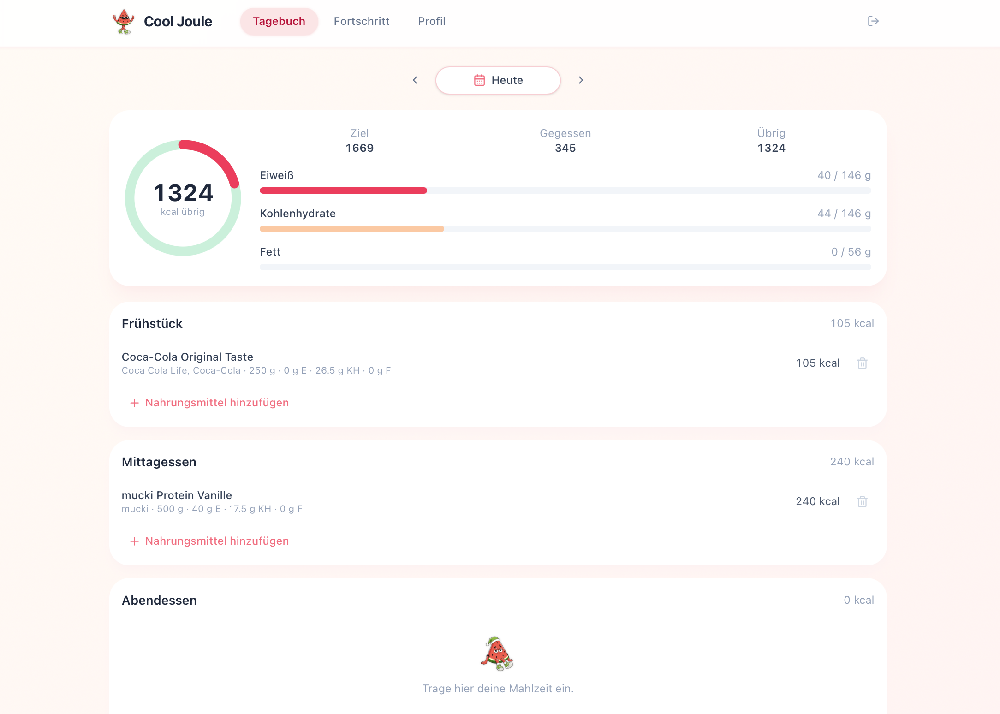

# Cool Joule

[](https://github.com/Simons-Github/cool-joule/actions/workflows/ci.yml) [](LICENSE)

A food diary for tracking meals, calories, macros and weight. The app UI is in German.

**Live:** [joule.berger-labs.com](https://joule.berger-labs.com). You need an account (email or Google); there is no demo or guest mode.



## Why

Logging food should take a few taps, not a database search every time. Cool Joule combines text search, barcode scan and photo estimation in one diary, and keeps each user's data in their own rows in Postgres.

<!-- TODO(Simon): add 1–2 sentences on why you built this -->

## Features

- Daily diary with date navigation, editing, undo for deletes, and copy from the previous day
- Add food by text search or barcode scan (Open Food Facts), as a custom food, or as a quick kcal entry
- Estimate nutrition from a meal photo with Gemini (own API key, or an allowlisted account with 5 analyses per 24 h)
- Import workouts from Strava or an iOS Shortcut, shown as net kcal in the diary
- Onboarding calculates calorie and macro targets (Mifflin-St Jeor); weight and calorie charts for 7, 30 and 90 days
- Data export and account deletion; installable as a PWA

## Tech stack

| Tool                                     | Role                                              |
| ---------------------------------------- | ------------------------------------------------- |
| TanStack Start, Router, Query + React 19 | App framework, routing, server functions          |
| Supabase                                 | Postgres, Auth (email, Google), Row Level Security |
| Tailwind CSS 4, shadcn/ui, Recharts      | Styling, components, charts                       |
| Vercel AI SDK with Google Gemini         | Photo analysis                                    |
| Open Food Facts, Strava API              | Food data, workouts                               |
| Vitest, ESLint, Prettier                 | Tests and linting                                 |
| Vercel                                   | Hosting                                           |

## Design decisions

**Secrets stay in server functions.** Calls that need a secret (Gemini, Strava, account deletion, token storage) live in `*.server.ts` modules behind TanStack Start server functions. The browser only gets the publishable Supabase key. The cost is an extra round trip for those calls, while plain diary CRUD goes straight to Supabase.

**Stored credentials are encrypted, quotas are enforced in the database.** User Gemini keys, Strava tokens and shortcut tokens are encrypted with AES-256-GCM (`src/lib/secret-box.ts`) and live in tables only the service role can read. The 5 per 24 h photo quota is claimed atomically in a Postgres function, so parallel requests cannot exceed it. The trade-off is that the encryption key must stay identical across environments.

**Row Level Security on every table, and the allowlist fails closed.** Per-user tables check `auth.uid()`. The app-level Gemini key is only used for accounts listed in `FOOD_PHOTO_APP_KEY_USER_IDS` or `FOOD_PHOTO_APP_KEY_EMAILS`; with both empty, nobody gets it. Responses also carry a Content-Security-Policy and other security headers (`src/lib/security-headers.ts`).

## Architecture

```
Browser (React)
    ├── Supabase JS client   ->  Auth + Postgres (RLS)
    └── Server functions     ->  photo analysis, quota, Gemini keys,
                                 Open Food Facts, account deletion,
                                 Strava OAuth/sync, shortcut tokens
iOS Shortcut  -> POST /api/shortcuts/exercise  -> exercise_logs (source: shortcut)
Strava        -> POST /api/strava/webhook      -> exercise_logs (source: strava)
```

## Running locally

Requires Node.js 22 and a Supabase project (apply `supabase/migrations/`).

```sh
git clone https://github.com/Simons-Github/cool-joule.git
cd cool-joule
cp .env.example .env   # set VITE_SUPABASE_URL and VITE_SUPABASE_PUBLISHABLE_KEY
npm install
npm run dev
npm test
```

The two Supabase variables are enough for the diary. Photo analysis, Strava, the Shortcut and account deletion need the server-side variables. See [docs/development.md](docs/development.md) for the full env table, Supabase setup, database tables, Strava, iOS Shortcut and troubleshooting, and [docs/deployment.md](docs/deployment.md) for the production checklist.

## Testing

Vitest unit tests cover nutrition math, Open Food Facts parsing, barcode handling, photo-analysis quota and allowlist logic, encryption, rate limiting, security headers, Strava and Shortcut handling. Run them with `npm test`. CI (`npm ci`, lint, test, build) runs on pushes and pull requests to `main`.

## Limitations

- The PWA is installable but does not sync offline.
- Photo analysis needs your own Gemini key (saved in the profile) or an allowlisted account.
- Apple Health cannot be read from a website. Import goes through Strava or the Shortcut webhook.
- Strava needs your own Strava developer app; the Shortcut works without Strava.
- AI photo estimates are approximate and should be checked before saving.

## License

MIT, see [LICENSE](LICENSE). Food data from [Open Food Facts](https://world.openfoodfacts.org/).
