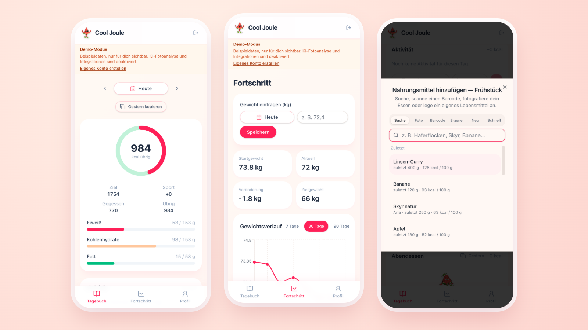
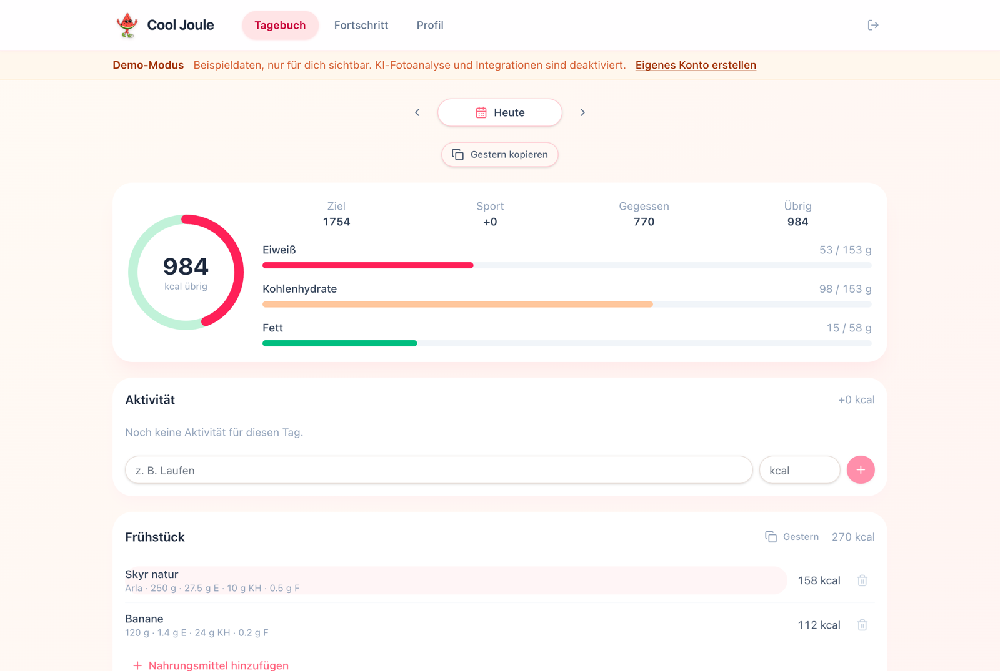
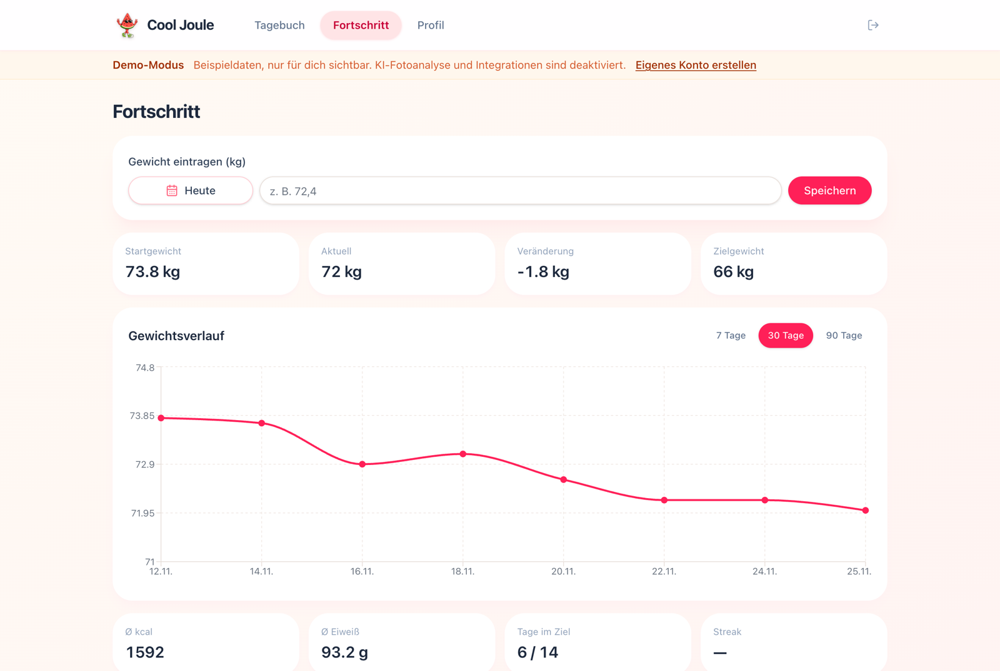

# Cool Joule

[](https://github.com/Simons-Github/cool-joule/actions/workflows/ci.yml) [](LICENSE)

A food diary for calories, macros and body weight. You can add food by search, barcode or meal photo. The interface is in German.

**Live demo:** [joule.berger-labs.com](https://joule.berger-labs.com). Click **Demo ausprobieren** on the login screen to get a private account with two weeks of sample data. No sign-up needed.



## Features

- Daily diary with meals, macros, copy from yesterday and undo for deletes
- Food search and barcode scan via Open Food Facts, plus custom foods and quick kcal entries
- Nutrition estimate from a meal photo with Google Gemini
- Calorie and macro targets from your profile (Mifflin-St Jeor), weight chart for 7, 30 or 90 days
- Workouts from Strava or an iOS Shortcut, counted against the daily budget
- Data export, account deletion, installable as a PWA

<p>
  
  
</p>

## Tech stack

| | |
| --- | --- |
| Frontend | React 19, TanStack Start, Router and Query, Tailwind CSS 4, shadcn/ui, Recharts |
| Backend | TanStack Start server functions on Vercel |
| Database and auth | Supabase (Postgres, Row Level Security, email and Google login) |
| AI | Google Gemini through the Vercel AI SDK |
| External APIs | Open Food Facts, Strava |
| Tooling | TypeScript, Vitest, ESLint, Prettier, GitHub Actions |

## How it works

The browser talks to Supabase directly for normal diary data. Row Level Security makes sure every user can only read and write their own rows. Anything that needs a secret goes through a server function instead: the Gemini call, the Strava OAuth flow, token storage and account deletion. These live in `*.server.ts` files, so the secrets never end up in the client bundle.

```
Browser (React)
  ├── Supabase client    -> Auth, Postgres (RLS)
  └── Server functions   -> Gemini, quota, Strava, tokens, account deletion
iOS Shortcut -> POST /api/shortcuts/exercise
Strava       -> POST /api/strava/webhook
```

A few decisions worth mentioning:

- **Photo analysis has a hard quota.** The app's own Gemini key is only used for allowlisted accounts, with 5 analyses per 24 hours. The limit is claimed in a single Postgres function, so parallel requests can't get around it. Other users can save their own Gemini key in the profile.
- **Stored secrets are encrypted.** User API keys, Strava tokens and Shortcut tokens are encrypted with AES-256-GCM (`src/lib/secret-box.ts`) and kept in tables the client can't read.
- **The demo is a real account.** The demo button uses Supabase anonymous sign-in and seeds sample data with the visitor's own session, so it goes through the same RLS rules as everyone else. Paid or external features (photo analysis, Strava, saving keys) are blocked on the server for demo users. A scheduled job deletes demo accounts after a week.

## Running locally

You need Node.js 22 and a Supabase project with the migrations from `supabase/migrations/` applied.

```sh
git clone https://github.com/Simons-Github/cool-joule.git
cd cool-joule
cp .env.example .env   # add VITE_SUPABASE_URL and VITE_SUPABASE_PUBLISHABLE_KEY
npm install
npm run dev
```

These two variables are enough for the diary. Photo analysis, Strava and the Shortcut need more. All variables, the database tables and the Strava and Shortcut setup are in [docs/development.md](docs/development.md). Deployment notes are in [docs/deployment.md](docs/deployment.md).

## Tests

`npm test` runs the Vitest suite. It covers the nutrition math, Open Food Facts parsing, barcode handling, the photo quota and allowlist, encryption, rate limiting, security headers, the Strava and Shortcut endpoints and the demo mode. GitHub Actions runs lint, tests and the build on every push.

## Limitations

- The PWA can be installed, but it doesn't work offline.
- Apple Health can't be read from a website, so workouts come in through Strava or the Shortcut.
- Photo estimates are rough. You should check them before saving.

## License

MIT. Food data comes from [Open Food Facts](https://world.openfoodfacts.org/).
